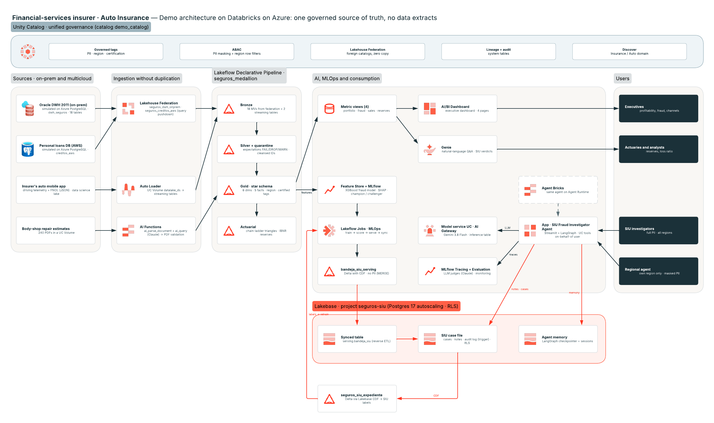

# Auto Insurance on Databricks — One Governed Source of Truth (FSI demo)

End-to-end demo for a **financial-services client (auto insurer, Mexico)** built on **Databricks on Azure**. It shows how to
move from a legacy DWH full of copies and data extracts to **one governed source of truth**: data is not copied, it becomes
trustworthy, nothing gets lost, and business users, actuaries, AI models and agents all consume the same numbers — with
governance travelling with the data to every user.

> **Everything is synthetic.** The client name, data and volumes are fictitious (generated with `generate_data.py`, fixed seed).
> Workspace identifiers were replaced with placeholders (`<WAREHOUSE_ID>`, `<tu_usuario>`, …).
> Code comments, prompts and object names are in Spanish (the demo was delivered in Spanish). Versión en español: [README_es.md](README_es.md)


## Business outcome (read this first)

**Problem.** An auto insurer has the data to fight claims fraud and manage reserves, but it is spread across 6–7 systems (a 2011 Oracle DWH with ~55,000 columns, a loans database in AWS, a separate data-science lake). Every area computes its own loss ratio, PII leaves in data extracts, actuarial runs take ~10 hours, and about 1 in 4 fraudulent claims is still paid.

**Outcome.** One governed source of truth that the business, actuaries, the fraud model and an SIU investigator agent all use, with the investigator's verdict flowing back to improve the model.

| Lever | Buyer KPI | Conservative estimate (year one) |
|---|---|---|
| Fraud model + SIU agent | Loss ratio | **−0.5 to −1.0 pt** ≈ MXN 10–20M / yr on a ~MXN 2.0B auto book |
| Chain-ladder on governed data | Reserve capital | **~MXN 15M** (one third of MXN 45M of case-reserve redundancy) |
| Certified metric views | Actuarial close | **~10 h → under 1 h** per run (~130 analyst-hours / month) |
| Ranked queue + agent-built case file | SIU productivity | **~80% of fraud in the top 10% of claims**, +30% cases per investigator |
| ABAC instead of copies | Governance | **−50% PII extracts** in year one, 100% of access audited |

**Total: MXN 25–35M of first-year value** on the auto book alone. Figures come from the working demo on synthetic data calibrated to the Mexican auto market and are meant to be re-validated in a 90-day pilot.

## The data journey (integrated, end to end)

```
1. RAW        generate_data.py → PostgreSQL ("Oracle on-prem" DWH + "AWS" loans DB), app JSON, body-shop PDFs
2. LAKEFLOW   Lakeflow Declarative Pipeline seguros_medallion: federation + Auto Loader → bronze → silver (expectations, quarantine) → gold star schema + actuarial
3. UNITY CAT. governed tags + ABAC (PII masking, region row filters) on gold; lineage, audit, Discover domain
4. ML / GENAI feature table → XGBoost (MLflow, champion/challenger) → scoring of open claims; ai_parse_document + ai_query on PDFs; LangGraph SIU agent on UC functions
5. LAKEBASE   scoring → bandeja_siu_serving (Delta, CDF) → synced table → SIU queue in ms; case file + notes + agent memory in Postgres (RLS)
6. GENIE      Genie space on 4 metric views + SIU verdicts: "loss ratio by package", "how often does the SIU confirm what the model flags?"
7. APP        Databricks App (Streamlit): queue, case file, agent chat with human approval, and an **Ask Genie** tab (Genie Conversation API, on-behalf-of the user)
8. LOOP       SIU verdicts → Lakebase CDF → Delta (seguros_siu_expediente) → labels for the next training run (89 in the last run)
```



Every stage reads the output of the previous one; nothing is exported by hand between them.

## Decisions and trade-offs

| Decision | Why | Trade-off / what we would do in production |
|---|---|---|
| **Federation first, not a migration** | Value in weeks while Oracle and AWS keep running; one query across systems | Federated reads depend on source performance; bronze materializes what we use, and hot tables can move to managed ingestion later |
| **ABAC policies on the gold layer only** | One policy per tag applies to every consumer (BI, Genie, ML, agent); pipelines that run as owner aren't affected | Bronze/silver are protected by grants instead; policies need governed tags kept current on every new table |
| **Serving table without PII + synced table** | Data minimization in the operational layer; incremental sync via Delta CDF; millisecond reads | One more table to maintain; refreshed with `MERGE` (not `CREATE OR REPLACE`) to keep CDF |
| **Role and region from UC, enforced by Postgres RLS** | The app connects as its service principal, but each transaction carries the user's UC role/region | RLS trusts the app to set the context; the table owner bypasses RLS (tested with an unprivileged role) |
| **Agent tools as UC functions called on-behalf-of the user** | The agent can never see more than the user; governance comes for free | Tools are SQL-shaped; complex logic lives in the functions |
| **LLM through a UC model service (AI Gateway)** | Swap models by routing, not code; inference table for audit | Message history isn't portable across model families (learned the hard way: tool-call formats differ) |
| **Human approval for every case** | Investigators stay accountable; regulators see a human decision | Slower than auto-opening; mitigated by the agent drafting the case |
| **SIU verdicts used for training only, not for testing** | Verdicts on model-ranked claims are biased toward the model; keeping test on the historical hold-out keeps the champion/challenger gate fair | Fewer new labels reach evaluation until enough accumulate |
| **Lakebase CDF (Beta) to close the loop** | No ETL code from Postgres back to Delta | Beta feature; fallback is a scheduled snapshot through the Lakebase UC catalog |
| **Synthetic data** | No customer data needed; fraud patterns are planted, so the model has signal to find | Metrics are optimistic versus real data (we say so and keep business estimates conservative) |
| **Streamlit app + Agent Bricks variant** | Streamlit for the full SIU workflow UI; Agent Bricks to show the managed runtime | Two surfaces to maintain; Agent Bricks needs approval as a second invocation (no `interrupt()` with user identity) |

## AI as a force multiplier

This prototype was built with an AI coding agent (Claude Code, driven by Databricks' internal FE toolkit) as a teammate, plus Databricks' own AI features.

| Tool | What it did |
|---|---|
| **Claude Code** (CLI agent) | Wrote and ran the generator, pipelines, governance SQL, ML notebooks, app and agent; deployed with the Databricks CLI; validated every step against the live workspace |
| **FE skills / plugins** | `databricks-lakebase` (projects, synced tables, roles), `html-slides` (Databricks-branded deck), Genie space builder, Lucid MCP (architecture diagram with official icons) |
| **Genie Code** | Added global filters (year, region, channel) to the AI/BI dashboard |
| **Databricks AI functions** | `ai_parse_document` + `ai_query` (Claude) to read and validate 240 body-shop PDFs |
| **MLflow GenAI** | LLM judges (`make_judge`) to evaluate the SIU agent; production monitoring of app traces |

Representative prompts (translated from Spanish):

- *"Add Lakebase to the SIU app: a synced table for the queue, a place for investigators to add notes, and persistent agent memory."* → produced the 4-part design (serving table + RLS case file + LangGraph checkpointer + CDF loop).
- *"Verify the RLS as a non-owner role, not as owner."* → caught that the table owner bypasses RLS and switched tests to `SET LOCAL ROLE`.
- *"Use conservative numbers that still show significant impact."* → business case ranges with explicit assumptions.
- *"Sanitize everything for a public repo: no client name, no workspace IDs."* → a reusable sanitizer and a scan before every commit.

Patterns that worked: **plan → build → verify against the live system** (never trust generated code until it ran); **ask before outward-facing actions** (publishing, sharing, merging); **keep memory notes of gotchas** (e.g. CDF needs `REPLICA IDENTITY FULL`); **let the agent propose, the human decide** — the same principle the SIU agent applies.

## Execution evidence

The build ran end to end, and the **output is committed as text** in [`evidence/`](evidence/README.md): executed notebooks with their cell outputs (`.ipynb` + `.md`), job-run logs of the agent, pipeline event-log results, the same governed query run as three roles, Lakebase RLS tests and CDF status, MLflow registry/evaluation/traces, Genie answers with their SQL and results, executed dashboard datasets, and app/deployment status. The index maps every stage to its files.

## Demo script

Tell → show → tell walkthrough (~15 min) with objection handling for a business and a technical stakeholder: [`docs/DEMO_ROLEPLAY.md`](docs/DEMO_ROLEPLAY.md).

---

## What's inside

| Layer | Databricks capability | Folder / file |
|---|---|---|
| **Sources** | Simulated "Oracle on-prem" DWH and "AWS" loans DB on PostgreSQL; app telemetry JSON; body-shop estimate PDFs | `generate_data.py`, `ddl_dwh.sql`, `ddl_creditos.sql`, `load_pg.py`, `inyectar_sucios_pg.py`, `documentos/generar_presupuestos.py` |
| **Zero-copy ingestion** | Lakehouse Federation (2 foreign catalogs) + Auto Loader on UC Volumes | `federacion/01_conexiones_federacion.sql`, `pipeline1_bronze_silver.sql` |
| **Medallion** | Lakeflow Declarative Pipeline: Bronze → Silver (FAIL/DROP/WARN expectations) → Gold (star schema) + **quarantine** + **actuarial** (chain-ladder triangles, IBNR) | `pipeline1_bronze_silver.sql`, `pipeline2_star.sql`, `pipeline3_cuarentena.sql` (generated by `gen_cuarentena.py`), `actuarial/`, `workspace_export/pipeline_medallion.json` |
| **"No extracts" governance** | Governed tags (PII, region, certification), **ABAC** policies (masking + row filters), data-science sandbox, audit and lineage | `gobierno/01..05_*.sql`, `gobierno/README.md` |
| **AI on documents** | `ai_parse_document` + `ai_query` (Claude) with JSON-schema `responseFormat` → repair-estimate validation | `documentos/01_extraccion_presupuestos.sql` |
| **Fraud ML** | Feature Engineering in UC, MLflow (nested runs, `mlflow.evaluate`, SHAP), UC Model Registry with **champion/challenger** aliases and a quality gate, batch scoring | `ml/01_features_entrenamiento.py`, `ml/02_scoring_batch.py`, `workspace_export/job_mlops.json` |
| **Semantic layer & BI** | 4 **metric views** (YAML v1.1), 4-page **AI/BI Dashboard** with global filters (year, region, channel), **Genie space** | `semantica/`, `workspace_export/dashboard.lvdash.json`, `workspace_export/genie_space.json` |
| **SIU fraud-investigator agent** | Databricks App (Streamlit + **LangGraph**); tools are UC functions executed **on behalf of the user** (ABAC applies); LLM through a **UC model service / AI Gateway**; human-in-the-loop; MLflow Tracing | `agente/01_funciones_agente.sql`, `agente/app/`, `workspace_export/app_config.json` |
| **Agent evaluation & monitoring** | `mlflow.genai.evaluate` with custom LLM judges (`make_judge`), code scorers, production monitoring | `agente/eval/` |
| **Agent Bricks** | Same agent on Agent Runtime (Session Store; approval as a second invocation) | `agente/agentbricks/` |
| **Lakebase** | Managed Postgres: **synced table** (reverse ETL) for the work queue, investigator **case file** (cases, notes, audit log) with **RLS**, **agent memory** (LangGraph checkpointer) and **Lakebase → Delta CDF** to close the loop (verdicts → retraining) | `lakebase/`, `agente/app/lakebase.py`, `workspace_export/lakebase_*.json` |
| **Diagram** | Reference architecture (PNG) | `diagrama/arquitectura.png` |

## Architecture (summary)

```
Sources (PostgreSQL: "Oracle on-prem" + "AWS", app JSON, PDFs)
   │  Lakehouse Federation (zero copy) · Auto Loader · AI Functions
   ▼
Lakeflow Declarative Pipeline: Bronze → Silver (+quarantine) → Gold star schema → Actuarial
   │
   ├─► Metric views ─► AI/BI Dashboard · Genie
   ├─► Feature Store + MLflow ─► MLOps job (train → score → serve → sync to Lakebase)
   └─► UC functions ─► SIU Agent App (LangGraph + UC model service) ─► MLflow Tracing/Evaluation
                                   │
                         Lakebase (synced table · case file with RLS · agent memory)
                                   │  Lakebase → Delta CDF
                                   ▼
                         seguros_siu_expediente (verdicts) ─► retraining + Genie
Unity Catalog governs everything: tags, ABAC, lineage, audit, Discover.
```

## Prerequisites

- Databricks workspace (tested on Azure) with Unity Catalog, serverless, Databricks Apps and Lakebase Autoscaling.
- A reachable PostgreSQL server (simulates the legacy sources).
- Databricks CLI ≥ 0.285 (`databricks postgres …`) and Python 3.10+ (`psycopg2` for `load_pg.py`).
- A SQL warehouse (its ID goes into `run_sql.py`, `semantica/build_*.py` and `app.yaml`).

## Placeholders to replace

| Placeholder | Meaning |
|---|---|
| `demo_catalog` | UC catalog for the demo (schemas `seguros_demo`, `seguros_ml`, `seguros_gobierno`, `seguros_sandbox_ds`, `seguros_siu_expediente`) |
| `<tu_usuario>` | Your workspace user (paths `/Workspace/Users/<tu_usuario>/…` and MLflow experiments) |
| `<WAREHOUSE_ID>` | SQL warehouse ID |
| `<PG_HOST>` / `<PG_SERVIDOR>` / `<PG_USER>` / `<SECRET_SCOPE>` | Source PostgreSQL and the secret scope holding its password |
| `<LAKEBASE_HOST>` | Lakebase endpoint host (`databricks postgres list-endpoints …`) |
| `<WORKSPACE_HOST>`, `<WORKSPACE_ID>`, `<ID>`, `<UUID>` | Your own workspace identifiers (dashboards, Genie, jobs, service principals) |

## Deployment order

1. **Synthetic data** — `python3 generate_data.py` (CSV + JSON into `./data`) and `python3 documentos/generar_presupuestos.py` (PDFs).
2. **Legacy sources** — `PGPASSWORD=… python3 load_pg.py` (creates `dwh_seguros` and `creditos_aws`). Optional: `inyectar_sucios_pg.py` (dirty records for the quarantine).
3. **Federation** — `federacion/01_conexiones_federacion.sql`.
4. **Volumes** — upload `data/telemetria/*` to `/Volumes/demo_catalog/seguros_demo/datalake_ds/app_autos/` and the PDFs to `documentos_siniestros/presupuestos/`.
5. **Pipeline** — import `pipeline1/2/3_*.sql` as notebooks and create the pipeline from `workspace_export/pipeline_medallion.json` (serverless). Run a full refresh.
6. **Governance** — `gobierno/01_roles_funciones.sql` → `02_tags_politicas.sql` → (`04_permisos.sql` is a template) → `03_demo_personas.sql` to switch roles live. See `gobierno/README.md`.
7. **AI on documents** — `documentos/01_extraccion_presupuestos.sql`.
8. **ML** — import `ml/*.py` as notebooks and create the job from `workspace_export/job_mlops.json` (single-user ML cluster).
9. **Semantic layer** — `semantica/metric_views.sql` (+ `reaplicar_tags_mv.sql`), `python3 semantica/build_dashboard.py`, `python3 semantica/build_genie.py`. The final dashboard (with global filters) is `workspace_export/dashboard.lvdash.json` — import it; `build_dashboard.py` builds the base version without filters.
10. **Agent** — `agente/01_funciones_agente.sql`; deploy `agente/app/` as a Databricks App (resources: SQL warehouse + Lakebase; user scope `sql`); grant the app service principal EXECUTE on the model service and CAN_EDIT on the experiment. Evaluation: `agente/eval/`. Agent Bricks variant: `agente/agentbricks/README.md`.
11. **Lakebase** — follow `lakebase/README.md`: project + `siu` database, `01_serving_bandeja.sql`, synced table, `02_ddl_operativo.sql`, `03_vistas_permisos.sql`, `04_sembrar_historial.py`, CDF config and `05_vistas_expediente_uc.sql`.

## Suggested demo flow (≈ 45–60 min)

1. **The problem**: many copies, extracts and different numbers per department.
2. **Zero copy**: Lakehouse Federation; join "on-prem" and "AWS" in one query.
3. **Trustworthy**: expectations and quarantine ("nothing gets lost"); certified gold layer.
4. **Live governance**: same query, three roles (investigator, actuary, regional agent) → different PII and regions, no code changes.
5. **Business**: dashboard and Genie on metric views (one definition of loss ratio, IBNR, conversion).
6. **AI**: fraud model with champion/challenger; PDFs read with AI.
7. **Agent**: investigates a claim, proposes opening a case, the human approves; traces and LLM judges.
8. **Lakebase**: millisecond work queue, investigator notes, the approval survives closing the app, verdicts come back as labels.

## Notes and gotchas

- Model metrics (high PR-AUC) come from synthetic data — say so during the demo.
- The SIU history in Lakebase (`04_sembrar_historial.py`) is synthetic; verdicts are drawn from the model probability.
- ABAC: policy-protected tables read from dedicated compute block self-joins → `spark.databricks.remoteFiltering.blockSelfJoins=false`.
- Lakebase CDF requires `REPLICA IDENTITY FULL`; tables skipped when the config was created are not re-evaluated (recreate the config).
- The Postgres table owner bypasses RLS: test with an unprivileged role (`SET LOCAL ROLE …`).
- More detail in each folder's README (`gobierno/`, `actuarial/`, `agente/`, `lakebase/`, `demo_en_vivo/`) — those are in Spanish.
