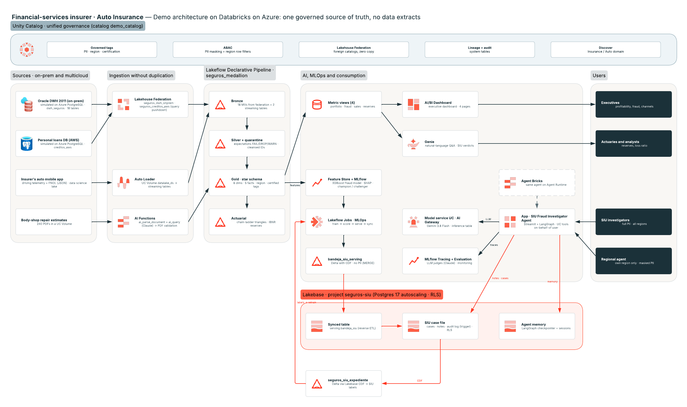

# Seguros de Autos en Databricks — Una sola fuente de verdad gobernada (demo FSI)

Demo de punta a punta para un **cliente del sector financiero (aseguradora, ramo Autos, México)** construido en
**Databricks on Azure**. Muestra cómo pasar de un DWH legacy con muchas copias y extractos a **una sola fuente de verdad
gobernada**: los datos no se copian, se vuelven confiables, nada se pierde, y el negocio, la actuaría, la IA y los
agentes consumen los mismos números con el gobierno viajando con el dato a cada usuario.

> **Todo es sintético.** El nombre del cliente, los datos y los volúmenes son ficticios (generados con `generate_data.py`, seed fijo).
> Los identificadores del workspace se reemplazaron por placeholders (`<WAREHOUSE_ID>`, `<tu_usuario>`, …).
> English version: [README_en.md](README_en.md)


## Resultado de negocio (léelo primero)

**Problema.** Una aseguradora de autos tiene los datos para combatir el fraude en siniestros y gestionar reservas, pero están repartidos en 6–7 sistemas (un DWH Oracle de 2011 con ~55,000 columnas, una BD de créditos en AWS, un data lake aparte para ciencia de datos). Cada área calcula su propia siniestralidad, la PII sale en extractos, los procesos actuariales tardan ~10 horas y cerca de 1 de cada 4 siniestros fraudulentos se sigue pagando.

**Resultado.** Una sola fuente de verdad gobernada que usan el negocio, la actuaría, el modelo de fraude y un agente investigador del SIU, y el veredicto del investigador regresa para mejorar el modelo.

| Palanca | KPI del comprador | Estimación conservadora (año 1) |
|---|---|---|
| Modelo de fraude + agente SIU | Siniestralidad | **−0.5 a −1.0 pt** ≈ MXN 10–20M / año sobre ~MXN 2.0B de prima de autos |
| Chain-ladder sobre datos gobernados | Capital en reservas | **~MXN 15M** (un tercio de MXN 45M de redundancia en reservas de caso) |
| Metric views certificadas | Cierre actuarial | **~10 h → menos de 1 h** por corrida (~130 horas-analista / mes) |
| Bandeja priorizada + expediente armado por el agente | Productividad SIU | **~80% del fraude en el 10% superior de siniestros**, +30% casos por investigador |
| ABAC en lugar de copias | Gobierno | **−50% de extractos con PII** en el año 1, 100% de accesos auditados |

**Total: MXN 25–35M de valor en el primer año** solo en autos. Las cifras salen del demo funcional con datos sintéticos calibrados al mercado mexicano de autos y se deben revalidar en un piloto de 90 días.

## El recorrido de los datos (integrado, de punta a punta)

```
1. DATOS CRUDOS generate_data.py → PostgreSQL (DWH "Oracle on-prem" + BD de créditos "AWS"), JSON de la app, PDFs de talleres
2. LAKEFLOW     Lakeflow Declarative Pipeline seguros_medallion: federación + Auto Loader → bronce → plata (expectations, cuarentena) → oro estrella + actuarial
3. UNITY CAT.   governed tags + ABAC (masking de PII, filtro por región) en oro; linaje, auditoría, dominio en Discover
4. ML / GENAI   feature table → XGBoost (MLflow, champion/challenger) → scoring de siniestros abiertos; ai_parse_document + ai_query sobre PDFs; agente SIU en LangGraph sobre funciones UC
5. LAKEBASE     scoring → bandeja_siu_serving (Delta, CDF) → synced table → bandeja SIU en ms; expediente + notas + memoria del agente en Postgres (RLS)
6. GENIE        Genie space sobre 4 metric views + veredictos SIU: "siniestralidad por paquete", "¿qué tanto confirma el SIU lo que marca el modelo?"
7. APP          Databricks App (Streamlit): bandeja, expediente, chat con el agente con aprobación humana
8. CICLO        veredictos SIU → CDF de Lakebase → Delta (seguros_siu_expediente) → etiquetas para el siguiente entrenamiento (89 en la última corrida)
```



Cada etapa lee la salida de la anterior; no hay exportaciones manuales entre ellas.

## Decisiones y trade-offs

| Decisión | Por qué | Trade-off / qué haríamos en producción |
|---|---|---|
| **Primero federación, no migración** | Valor en semanas mientras Oracle y AWS siguen operando; una consulta entre sistemas | Las lecturas federadas dependen del desempeño de la fuente; bronce materializa lo que se usa y las tablas calientes pueden pasar a ingesta administrada después |
| **Políticas ABAC solo en la capa oro** | Una política por tag aplica a todos los consumidores (BI, Genie, ML, agente); los pipelines que corren como owner no se ven afectados | Bronce/plata se protegen con permisos; cada tabla nueva necesita sus governed tags al día |
| **Tabla de serving sin PII + synced table** | Minimización de datos en la capa operativa; sync incremental vía CDF de Delta; lecturas en milisegundos | Una tabla más que mantener; se refresca con `MERGE` (no `CREATE OR REPLACE`) para conservar el CDF |
| **Rol y región desde UC, aplicados por RLS en Postgres** | La app se conecta como su service principal, pero cada transacción lleva el rol/región del usuario en UC | El RLS confía en que la app fije el contexto; el owner de las tablas se salta el RLS (probado con un rol sin privilegios) |
| **Herramientas del agente como funciones UC con la identidad del usuario** | El agente nunca ve más que el usuario; el gobierno viene incluido | Las herramientas son SQL; la lógica compleja vive en las funciones |
| **LLM vía model service de UC (AI Gateway)** | Cambiar de modelo es un cambio de ruteo, no de código; inference table para auditoría | El historial de mensajes no es portable entre familias de modelos (los formatos de tool calls difieren) |
| **Aprobación humana de cada caso** | El investigador sigue siendo responsable; el regulador ve una decisión humana | Más lento que abrir casos automáticamente; se compensa con el borrador que arma el agente |
| **Veredictos SIU solo para entrenar, no para evaluar** | Los veredictos sobre siniestros que el modelo priorizó están sesgados hacia el modelo; mantener el test en el hold-out histórico deja justa la compuerta champion/challenger | Menos etiquetas nuevas llegan a la evaluación hasta que se acumulen |
| **CDF de Lakebase (Beta) para cerrar el ciclo** | Sin código ETL de Postgres de regreso a Delta | Función en Beta; el respaldo es un snapshot programado vía el catálogo UC de Lakebase |
| **Datos sintéticos** | No se necesitan datos del cliente; los patrones de fraude están sembrados, así que el modelo tiene señal | Las métricas son optimistas frente a datos reales (lo decimos y mantenemos conservadoras las estimaciones de negocio) |
| **App Streamlit + variante Agent Bricks** | Streamlit para todo el flujo del SIU; Agent Bricks para mostrar el runtime administrado | Dos superficies que mantener; Agent Bricks requiere la aprobación como segunda invocación (sin `interrupt()` con identidad de usuario) |

## La IA como multiplicador

Este prototipo se construyó con un agente de código con IA (Claude Code, con el toolkit interno de Field Engineering de Databricks) como compañero de equipo, además de las funciones de IA de Databricks.

| Herramienta | Qué hizo |
|---|---|
| **Claude Code** (agente CLI) | Escribió y ejecutó el generador, los pipelines, el SQL de gobierno, los notebooks de ML, la app y el agente; desplegó con el Databricks CLI; validó cada paso contra el workspace real |
| **Skills / plugins de FE** | `databricks-lakebase` (proyectos, synced tables, roles), `html-slides` (deck con marca Databricks), builder de Genie spaces, MCP de Lucid (diagrama con íconos oficiales) |
| **Genie Code** | Agregó filtros globales (año, región, canal) al dashboard AI/BI |
| **Funciones de IA de Databricks** | `ai_parse_document` + `ai_query` (Claude) para leer y validar 240 PDFs de talleres |
| **MLflow GenAI** | Jueces LLM (`make_judge`) para evaluar al agente SIU; monitoreo en producción de los traces de la app |

Prompts representativos:

- *"Agrega Lakebase a la app del SIU: una synced table para la bandeja, que los investigadores puedan agregar notas y memoria persistente del agente."* → produjo el diseño de 4 piezas (tabla de serving + expediente con RLS + checkpointer de LangGraph + ciclo con CDF).
- *"Verifica el RLS con un rol que no sea owner."* → detectó que el owner se salta el RLS y cambió las pruebas a `SET LOCAL ROLE`.
- *"Usa números conservadores pero que sigan mostrando un impacto importante."* → rangos del business case con supuestos explícitos.
- *"Sanitiza todo para un repo público: sin nombre del cliente ni IDs del workspace."* → un sanitizador reutilizable y un escaneo antes de cada commit.

Patrones que funcionaron: **planear → construir → verificar contra el sistema real** (no confiar en código generado hasta que corre); **preguntar antes de acciones hacia afuera** (publicar, compartir, hacer merge); **guardar notas de los gotchas** (p. ej. el CDF necesita `REPLICA IDENTITY FULL`); **el agente propone, el humano decide**, el mismo principio que aplica el agente SIU.

## Guion del demo

Recorrido tell → show → tell (~15 min) con manejo de objeciones para un stakeholder de negocio y uno técnico: [`docs/DEMO_ROLEPLAY.md`](docs/DEMO_ROLEPLAY.md) (en inglés).

---

## Qué incluye

| Capa | Capacidad de Databricks | Carpeta / archivo |
|---|---|---|
| **Fuentes** | DWH "Oracle on-prem" y BD de créditos "AWS" simulados en PostgreSQL; telemetría JSON de la app; PDFs de presupuestos | `generate_data.py`, `ddl_dwh.sql`, `ddl_creditos.sql`, `load_pg.py`, `inyectar_sucios_pg.py`, `documentos/generar_presupuestos.py` |
| **Ingesta sin copiar** | Lakehouse Federation (2 foreign catalogs) + Auto Loader sobre Volumes | `federacion/01_conexiones_federacion.sql`, `pipeline1_bronze_silver.sql` |
| **Medallion** | Lakeflow Declarative Pipeline: Bronce → Plata (expectations FAIL/DROP/WARN) → Oro (modelo estrella) + **cuarentena** + **actuarial** (triángulos chain-ladder, IBNR) | `pipeline1_bronze_silver.sql`, `pipeline2_star.sql`, `pipeline3_cuarentena.sql` (generado por `gen_cuarentena.py`), `actuarial/`, `workspace_export/pipeline_medallion.json` |
| **Gobierno "sin extractos"** | Governed tags (PII, región, certificación), políticas **ABAC** (masking + row filters), sandbox de ciencia de datos, auditoría y linaje | `gobierno/01..05_*.sql`, `gobierno/README.md` |
| **IA sobre documentos** | `ai_parse_document` + `ai_query` (Claude) con `responseFormat` JSON schema → validación de presupuestos de taller | `documentos/01_extraccion_presupuestos.sql` |
| **ML de fraude** | Feature Engineering in UC, MLflow (runs anidados, `mlflow.evaluate`, SHAP), UC Model Registry con alias **champion/challenger** y compuerta de calidad, scoring batch | `ml/01_features_entrenamiento.py`, `ml/02_scoring_batch.py`, `workspace_export/job_mlops.json` |
| **Capa semántica y BI** | 4 **metric views** (YAML v1.1), **AI/BI Dashboard** de 4 páginas con filtros globales (año, región, canal), **Genie space** | `semantica/`, `workspace_export/dashboard.lvdash.json`, `workspace_export/genie_space.json` |
| **Agente investigador de fraude (SIU)** | Databricks App (Streamlit + **LangGraph**), herramientas = funciones de UC ejecutadas **on-behalf-of** del usuario (ABAC aplica), LLM vía **model service de UC / AI Gateway**, human-in-the-loop, MLflow Tracing | `agente/01_funciones_agente.sql`, `agente/app/`, `workspace_export/app_config.json` |
| **Evaluación y monitoreo del agente** | `mlflow.genai.evaluate` con jueces LLM personalizados (`make_judge`), scorers de código, monitoreo en producción | `agente/eval/` |
| **Agent Bricks** | El mismo agente en Agent Runtime (Session Store, aprobación como 2ª invocación) | `agente/agentbricks/` |
| **Lakebase** | Postgres administrado: **synced table** (reverse ETL) de la bandeja, **expediente** del investigador (casos, notas, bitácora) con **RLS**, **memoria del agente** (checkpointer LangGraph) y **CDF Lakebase → Delta** para cerrar el ciclo (veredictos → reentrenamiento) | `lakebase/`, `agente/app/lakebase.py`, `workspace_export/lakebase_*.json` |
| **Diagrama** | Arquitectura de referencia (PNG) | `diagrama/arquitectura.png` |

## Arquitectura (resumen)

```
Fuentes (PostgreSQL: "Oracle on-prem" + "AWS", JSON app, PDFs)
   │  Lakehouse Federation (sin copiar) · Auto Loader · AI Functions
   ▼
Lakeflow Declarative Pipeline: Bronce → Plata (+cuarentena) → Oro estrella → Actuarial
   │
   ├─► Metric views ─► AI/BI Dashboard · Genie
   ├─► Feature Store + MLflow ─► Job MLOps (entrena → scoring → serving → sync Lakebase)
   └─► Funciones UC ─► App Agente SIU (LangGraph + model service UC) ─► MLflow Tracing/Evaluación
                                   │
                         Lakebase (synced table · expediente con RLS · memoria del agente)
                                   │  CDF Lakebase → Delta
                                   ▼
                         seguros_siu_expediente (veredictos) ─► reentrenamiento + Genie
Unity Catalog gobierna todo: tags, ABAC, linaje, auditoría, Discover.
```

## Requisitos

- Workspace de Databricks (probado en Azure) con Unity Catalog, serverless, Databricks Apps y Lakebase Autoscaling.
- Un servidor PostgreSQL accesible (simula las fuentes legacy).
- Databricks CLI ≥ 0.285 (`databricks postgres …`) y Python 3.10+ (`psycopg2` para `load_pg.py`).
- Un SQL warehouse (su ID va en `run_sql.py`, `semantica/build_*.py` y `app.yaml`).

## Placeholders a reemplazar

| Placeholder | Qué es |
|---|---|
| `demo_catalog` | Catálogo de UC donde vive el demo (schemas `seguros_demo`, `seguros_ml`, `seguros_gobierno`, `seguros_sandbox_ds`, `seguros_siu_expediente`) |
| `<tu_usuario>` | Tu usuario del workspace (rutas `/Workspace/Users/<tu_usuario>/…` y experimentos MLflow) |
| `<WAREHOUSE_ID>` | ID del SQL warehouse |
| `<PG_HOST>` / `<PG_SERVIDOR>` / `<PG_USER>` / `<SECRET_SCOPE>` | PostgreSQL fuente y secret scope con su contraseña |
| `<LAKEBASE_HOST>` | Host del endpoint de Lakebase (`databricks postgres list-endpoints …`) |
| `<WORKSPACE_HOST>`, `<WORKSPACE_ID>`, `<ID>`, `<UUID>` | Identificadores propios de tu workspace (dashboards, Genie, jobs, service principals) |

## Orden de despliegue

1. **Datos sintéticos** — `python3 generate_data.py` (CSV + JSON en `./data`) y `python3 documentos/generar_presupuestos.py` (PDFs).
2. **Fuentes legacy** — `PGPASSWORD=… python3 load_pg.py` (crea `dwh_seguros` y `creditos_aws`). Opcional: `inyectar_sucios_pg.py` (registros sucios para la cuarentena).
3. **Federación** — `federacion/01_conexiones_federacion.sql`.
4. **Volumes** — sube `data/telemetria/*` a `/Volumes/demo_catalog/seguros_demo/datalake_ds/app_autos/` y los PDFs a `documentos_siniestros/presupuestos/`.
5. **Pipeline** — importa `pipeline1/2/3_*.sql` como notebooks y crea el pipeline con `workspace_export/pipeline_medallion.json` (serverless). Corre un full refresh.
6. **Gobierno** — `gobierno/01_roles_funciones.sql` → `02_tags_politicas.sql` → (`04_permisos.sql` es plantilla) → `03_demo_personas.sql` para cambiar de rol en vivo. Ver `gobierno/README.md`.
7. **IA sobre documentos** — `documentos/01_extraccion_presupuestos.sql`.
8. **ML** — importa `ml/*.py` como notebooks y crea el job con `workspace_export/job_mlops.json` (cluster ML single-user).
9. **Capa semántica** — `semantica/metric_views.sql` (+ `reaplicar_tags_mv.sql`), `python3 semantica/build_dashboard.py`, `python3 semantica/build_genie.py`. La versión final del dashboard (con filtros globales) es `workspace_export/dashboard.lvdash.json` — impórtala; `build_dashboard.py` genera la versión base sin filtros.
10. **Agente** — `agente/01_funciones_agente.sql`; despliega `agente/app/` como Databricks App (recursos: SQL warehouse + Lakebase; scope de usuario `sql`); otorga al service principal EXECUTE sobre el model service y CAN_EDIT sobre el experimento. Evaluación: `agente/eval/`. Variante Agent Bricks: `agente/agentbricks/README.md`.
11. **Lakebase** — sigue `lakebase/README.md`: proyecto + base `siu`, `01_serving_bandeja.sql`, synced table, `02_ddl_operativo.sql`, `03_vistas_permisos.sql`, `04_sembrar_historial.py`, CDF config y `05_vistas_expediente_uc.sql`.

## Guion sugerido (≈ 45–60 min)

1. **El problema**: muchas copias, extractos y números distintos por área.
2. **Sin copiar**: Lakehouse Federation; join entre "on-prem" y "AWS" en una consulta.
3. **Confiable**: expectations y cuarentena ("nada se pierde"); oro certificado.
4. **Gobierno en vivo**: misma consulta, tres roles (investigador, actuario, agente regional) → PII y regiones distintas, sin cambiar el código.
5. **Negocio**: dashboard y Genie sobre metric views (una sola definición de siniestralidad, IBNR, conversión).
6. **IA**: modelo de fraude con champion/challenger; PDFs leídos con IA.
7. **Agente**: investiga un siniestro, propone abrir un caso, el humano aprueba; traces y jueces LLM.
8. **Lakebase**: bandeja en milisegundos, notas del investigador, la aprobación sobrevive a cerrar la app, los veredictos regresan como etiquetas.

## Notas y gotchas

- Las métricas del modelo (PR-AUC alto) se deben a que los datos son sintéticos — dilo en el demo.
- El historial del SIU en Lakebase (`04_sembrar_historial.py`) es sintético; los veredictos se sortean con la probabilidad del modelo.
- ABAC: las tablas con políticas leídas desde cómputo dedicado bloquean self-joins → `spark.databricks.remoteFiltering.blockSelfJoins=false`.
- Lakebase CDF requiere `REPLICA IDENTITY FULL`; las tablas omitidas al crear el config no se re-evalúan (recrear el config).
- El owner de las tablas en Postgres se salta el RLS: prueba con un rol sin privilegios (`SET LOCAL ROLE …`).
- Más detalle en los README de cada carpeta (`gobierno/`, `actuarial/`, `agente/`, `lakebase/`, `demo_en_vivo/`).
